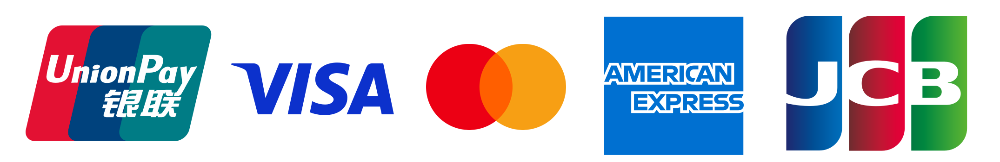
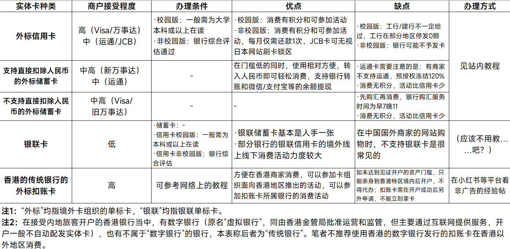

# 用于线上国际支付的银行卡推荐及其办理方式

> 编者：Harico

> 提及的任一银行没有直接或间接参与本文编写，也没有主动赞助本站或其编者。
> 
> **警告：** 请勿出于任何理由向他人出借与售卖银行卡（具体表现为借出银行卡本体、把卡号/有效期/CVV2中任两个或以上的信息直接告知给他人、卖出银行卡本体或卡号/有效期/CVV2中任两个或以上的信息、协助进行其他非正常消费）。因为这些行为对银行账户有巨大风险；如相关卡片被用于诈骗等违法用途，出借/借入和售卖/购买者双方都违法！

::: details 本文现在的版本是：2.1
  2026.11.25  - 2.1 - 精简与优化了全文，使其更易读。

  2026.04.11  - 2.0 - 在 1.0.1 发布后的两年，新万事达储蓄卡开始发行，已有4家银行的新万事达储蓄卡完整支持网付；同时，大陆和香港的金融监管部门联合银行推出“跨境支付通”，港卡小额入金变得省时而方便，让港卡也成为了部分人的境外消费的办卡新选择；基于上述事实，重构本文内容。
  
  2024.04.27  - 1.0.1 - 添加对于DLsite等限制卡组织的商家的提醒；提及即将发行的万事达人民币卡；删除线上虚拟卡章节；其他表述优化。
  
  2023.11.04  - 1.0 - 初版
:::

> {.is-warning}

想在海外网站消费时，各位很多时候会发现网站不支持微信支付和支付宝。这篇教程就来全面地说一下用于线上国际支付的银行卡推荐及其办理方式。
首先，讲讲两个概念：卡组织、储蓄卡/信用卡。 

**卡组织**，可以理解为 持卡人、银行、商家 之间的桥梁。有了卡组织，商家可以快速接受来自世界各地的银行卡；我们作为消费者也省心，只要看到某个卡组织的Logo，一般就能用该卡组织的卡在商家消费。在中国大陆，我们一般会办到如下卡组织的卡片：银联/UnionPay 、Visa、Mastercard（万事达）、美国运通（American Express/AMEX）、JCB。而它们的最新版Logo如下图所示。有些地方可能还在用旧版Logo，或者用了最新版Logo的变体，这是正常的。

**在中国大陆以外的国家和地区** ，绝大部分商家同时支持Visa和Mastercard，是否支持银联、JCB、运通等则依地区习惯和具体商家而定。但是，有时也会遇到同时 **不支持** Visa和Mastercard的情况，多见于日本，因为这些商家拒绝执行Visa和Mastercard要求的整改；同时，部分商家由于各种原因，会进行「限区」，只能使用当地发行的卡来消费，不过在部分日本商家可能可以使用JCB卡绕过。

**储蓄卡/借记卡/Debit Card** 是同一种东西，都是先存钱、再消费；**0额度的信用卡**，也需要先存钱、再消费。**有信用额度的信用卡**，则是先用（->消费）再付（->还款）。本文及其附属文章介绍的外标储蓄卡，在很多商家处是可以当作信用卡（Credit Card / クレジットカード）来消费的，不用担心。

接下来，我们来看看各种类型的卡的优劣。本站重点介绍外标信用卡和外标储蓄卡，相关办理和使用教程见下文。

## 外标信用卡（Visa、Mastercard、JCB、运通）

如你是大学本科或以上在读的大学生，可以考虑办理校园版的外标信用卡，在不提交由非学生成年人签署的还款承诺书的前提下的信用额度为0（先存钱后消费）；如父母签署还款承诺书，部分银行会给大学生批出有信用额度的信用卡。目前，在不提交承诺书的背景下，校园版的外标信用卡只有 **[工商银行星座卡校园版](/pay/icbc-credit-student)** 。

如已满18岁，且不是大学生，可以申请办理有额度的外标信用卡，具体推荐可看「[外标信用卡介绍·推荐·办理·使用](/pay/credit-regular)」。
> 「外标信用卡介绍·推荐·办理·使用」暂未编写完成。
{.is-info}

## 外标储蓄卡（由中国大陆的银行发行的Visa、Mastercard、运通储蓄卡）

仅介绍满血支持境外线上支付、持卡不收年费、消费不收手续费的卡种。

对于大部分人，笔者建议办理 **[新 万事达 储蓄卡](/pay/mc-debit)** ，大部分商家都支持，且消费前只需存入人民币；而办理 **[运通人民币储蓄卡](/pay/amex-debit)** 后还可以用于在一些不支持Visa和万事达、却支持运通的商家支付，作为备用。

如果由于各种原因需要存入非美元外币后消费，或希望在汇率低时囤外币、在以后再消费，可以办理 [仍能办理且网付可用的 Visa/旧万事达 外币储蓄卡](/pay/classic-debit) 。
