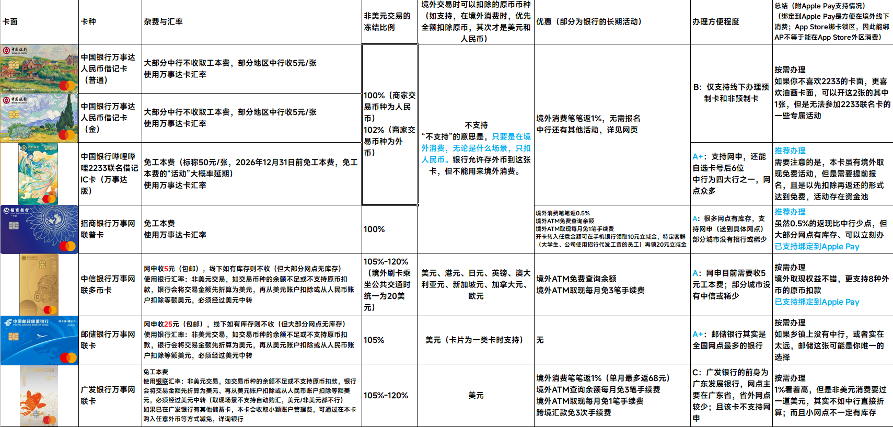

# 介绍、办理与使用 - 新 万事达 储蓄卡

::: details 本文现在的版本是：2.0
（改正了存在但不影响意思表达的错字 不会记入更新日志，改错字只更新版本号。）
2026.11.25  - 2.0 - 大改版。

2026.11.23  - 1.0.2 - 删改了卡种列表的文案。

2026.11.16  - 1.0.1 - 给邮储的卡补充部分内容。

2026.04.11  - 1.0 - 本文定稿。
:::

> **编者：** Harico
> 本文是「[用于线上国际支付的银行卡推荐及其办理方式](/pay/bank)」的附属文章；本文适用于[关于地区表达的说明](regional_expression)。

## 1. 介绍

凭着**消费直接扣人民币^、境内境外都能用** 两大优点，很多人纷纷办理**新万事达储蓄卡** 。对于不想/不能办理外标信用卡，却想畅快地在境外线上消费的人来说，新万事达储蓄卡非常好！
^ 部分卡种支持在境外线上、线下消费时直接扣人民币。本文所介绍的卡种，全部具有该特性。

这些卡都是储蓄卡，又名借记卡，英文名为Debit Card，先存钱、再消费，办卡不查征信、也没有信用额度，学生和不能/不想办信用卡的其他人都可以正常办理。

::: tip 何为旧万事达、新万事达？VISA和万事达有什么区别？
**旧** 万事达卡，可以简单理解为由中国大陆的银行发行，且**不支持绑定微信、支付宝等** 境内支付平台的万事达卡。

**新** 万事达卡，可以简单理解为由中国大陆的银行发行，且**支持绑定微信、支付宝等** 境内支付平台的万事达卡。万事达卡与银行通常会称“中国全新万事达卡”“全新万事达卡”等。境内可绑微信、支付宝、抖音、美团等进行消费，微信和支付宝的余额也可照常提现，使用本行或他行的手机银行可以将其他银行卡的人民币转到该卡；境外在大多数线上线下商家可以畅快消费，很多商家都同时支持VISA和万事达卡。

**目前** 所有VISA储蓄卡都不支持在消费时直接扣人民币，必须搭配一张同银行的非VISA储蓄卡用于购汇，且**VISA和万事达卡的商家覆盖率相差不大**。如果没有特殊需求（如参加VISA专属活动），没有必要专门办VISA储蓄卡。
:::

办了卡之后，我们就能方便地在境外网站购买实物和虚拟物品，在Fanbox等创作者支持平台通过订阅等来更直接地支持创作者，还可以给境外的非营利组织（[Internet Archive](https://archive.org)、[OTW](https://www.transformativeworks.org/)（提供AO3等服务的非营利组织）等）捐款。

## 2. 卡种列表与推荐

笔者在本文只介绍支持在线申请、满血支持境外线上支付、持卡不收年费、消费不收手续费的卡种。在筛选后，境内银行值得办理的新万事达储蓄卡及其优缺点如下图所示：

补充1：对于中国银行新万事达储蓄卡，无论是否付费开通短信动账提醒服务，持卡人在境外网站消费后或在境外线下商家消费后，都会收到免费的短信提醒；其他银行暂时没有相关减免。

补充2：中行的新万事达储蓄卡，在开卡后可手动领取满20元减10元的支付宝立减金，可在微信搜索「全新万事达卡开卡礼」以寻找相关文章，或在这里直达：[https://mcc.xunliandata.com/b-plus/benifit/bocjkl/boc-gift/home](https://mcc.xunliandata.com/b-plus/benifit/bocjkl/boc-gift/home)（上海讯联为中行和万事达卡的合作方之一；如仍对输入敏感信息存在顾虑，可在微信搜索「全新万事达卡开卡礼」以寻找相关文章，最终进入的链接与本文所给的一致）

补充3：中国银行哔哩哔哩 2233 联名借记 IC 卡（万事达版）有开卡和用卡的专属活动，请前往中国银行App搜索「B站专区」以详细了解。

对于在不同地区、有不同需求的读者来说，**适合自己且方便办理的卡才是最好的卡**，可以参考上文权衡一下要办哪家的。

## 3. 申卡指南

### 3.1 申请前

请注意：

1. 中国银行、招商银行、中信银行、邮储银行支持 **网上申请（下称网申）** 和 **柜台申请**，而广发银行只支持柜台申请。无论是网申还是柜台申请，都请准备好身份证件和**本人实名的手机号**，且前往网点时必须携带手机（或支持接收短信的平板电脑）。
2. **最好年满 16 周岁**。根据监管规定，未满 16 周岁人士必须有监护人陪同才能激活银行卡，且部分银行不支持未满 16 周岁的用户网申储蓄卡（如招商银行）或/和开通手机银行；部分地区的部分银行可能不给未成年人开通手机银行。
3. **在相关银行**持有的实体储蓄卡数量必须小于 4 张。每人，**在每家银行**，最多只能持有 4 张 实体 储蓄卡。如果你已持有4张或以上，请注销多余的卡片，最多留下3张。（小技巧：如果部分卡只是拿来收藏卡面、平时不用，可以故意不带卡去银行，做挂失销户）

### 3.2 申请步骤

**中国银行 - 网申：** 网申需要客户持有中国居民身份证、**年满 18 岁** ，在中国银行的有效的实体储蓄卡数量已经小于 4 张；网申的卡面均为竖版；网申的卡的持卡人姓名均统一以BOC DEBIT代替，暂不支持印制真实的持卡人姓名。**中行新用户** 建议在哔哩哔哩“中国银行APP”相关视频的置顶链接进行申请，比如[BV12aWy6aEif](https://www.bilibili.com/video/BV12aWy6aEif)；中行老客户可以在中国银行App搜索“B站专区”来申请，且老客户在申请时需要注意尾号不要跟还在用的中行卡一样，否则无法同时绑在微信上（如确认只有一张卡需要绑微信，可忽略此条说明）。注意，在申请过程中选择的网点就是领卡网点，提交申请后无法更改，请提前查询你去哪个网点最方便。

**中国银行 - 柜台申请** 是在中行的柜台开立该卡的预制卡/非预制卡——如果网点有该卡的现卡，且没有选号需求和印制姓名的需求，就直接开卡，此为预制卡；如果网点没有现卡，或有选号需求、印制姓名需求，需让柜员办理名为“个人开非预制卡”的业务，待1-4周后卡片寄达办理网点，再前往网点进行领卡。柜台申请在理论上不限制客户的身份证件类型和年龄（但如未满16岁，银行需执行央行规定，由监护人陪同开卡；满16岁的未成年人建议提前咨询所在地中行，未成年人新客户是否能开通手机银行，部分分支行在原则上不给未成年人客户新开通手机银行，这会影响境外线上支付功能的正常开通），如在中国银行的有效的实体储蓄卡数量大于等于4张可先当场办理销户；柜台开立预制卡可开的卡面取决于柜台库存（如果实在很想要横板，可以尝试让网点帮忙请领，到货后再开卡），非预制卡的卡面均为竖版；预制卡的持卡人姓名位置均打印BOC DEBIT，开立非预制卡如想打印持卡人姓名，建议**反复叮嘱**柜员在操作时维护“卡片印制姓名”字段。

**招商银行：** (1) 即场开卡：如果招行离你很近，可以直接前往确认是否有万事达储蓄卡的库存，有的话直接开卡。如果想提前确认库存，可在「招商银行」App查询附近网点及其营业时间、联系电话，在网点营业时间打电话询问是否可以现场办理万事达储蓄卡。(2) 如果网点没有现成卡板，可下载安装「招商银行」App，搜索「万事达借记卡」，点击大海报，再点击「点击办卡」，便可填写信息并提交，卡片会送到你选择的网点，到了会通知你。

**中信银行：** 下载安装「中信银行」App，搜索「银行卡超市」并进入，再搜索「万事达」。

**广发银行：** 提前打电话咨询网点。

**邮储银行：** 下载安装「邮储银行」App，搜索「储蓄卡申请」并进入，点击「我要办卡」，再选择「万事有礼」，点击普卡的「申请」。

### 3.3 申请进度查询

**中国银行 - 网申：** 重新进入申请入口，就能查询进度。如果自申请后1个月仍是「制卡中」，建议在工作时间打电话给网点，询问是否到卡，并报出卡号尾号或完整卡号。

**中国银行 - 柜台申请（非预制卡）：** 在柜台申请非预制卡的2-3周后，打电话给网点查询到卡情况。

**招商银行：** 在「招商银行」App，搜索「储蓄卡办卡进度」。

**中信银行：** 在「中信银行」App点「全部」，在账户管理板块找到「申卡记录查询」。

**邮储银行：** 关注「中国邮政储蓄银行」微信服务号，依次进入：金融 - 业务大厅.轻银行 - 储蓄卡申请 - 查询办理进度

### 3.4 现场办理或网申激活卡片的注意事项

中行、招行的网申都是将卡寄到网点，收到通知后去申请时选择的网点激活；中信和邮储是把卡寄到申请时填写的地址，实体卡需要激活，带着卡去网点激活。

职员会询问办卡用途，正常说出你的用途即可：出境消费、在境外正规网站买东西、境外取现可以免费（如果你办的卡种有这个权益）……

新万事达储蓄卡都能存人民币，因此会分一类卡、二类卡。办成二类卡并不影响正常境外消费，其中中行的如果办成二类卡可能影响部分海外旅游退税、但不影响消费退款。

短信提醒可按需开通。中行无需开通，因为中国银行旧万事达/新万事达储蓄卡的持卡人在境外网站消费后或在境外线下商家消费后，都会收到免费的短信提醒。

办卡后，职员可能会由于各种原因要求你注册一些东西，请注意：扫码领立减金和参与活动是可以的，你获得了优惠，也帮他们他们完成KPI；开银行卡不需要开通数字人民币、证券账户等，可以拒绝开通。、

办完不要急着离开，如果职员未引导你在柜台/智能柜台开通手机银行，也没有引导你在手机上操作开通，建议立刻将卡绑定到手机银行；也建议立刻绑定任意支付平台（除云闪付），比如微信、支付宝、美团等，如果绑定失败，马上找银行解决，因为中行的部分职员会将预留手机号填到别的地方，导致无法绑定和正常消费。

**成功办理卡片后，请尽快执行[下文的「激活后、开始使用前」](#_4-激活后、开始使用前)中的操作。**

## 4. 激活后、开始使用前

> 在「晒卡」时，请不要拍卡片的背面！！否则如果因此被盗刷，责任在你，银行无责。

> **提醒：** 中国银行哔哩哔哩 2233 联名借记 IC 卡（万事达版）在申请时可以自选卡号后6位。请尽量不要晒出完整的后6位，以免被不法分子利用。

> **警告：** 请勿出于任何理由向他人出借与售卖银行卡（具体表现为借出银行卡本体、把卡号/有效期/CVV2中任两个或以上的信息直接告知给他人、卖出银行卡本体或卡号/有效期/CVV2中任两个或以上的信息、协助进行其他非正常消费）。因为这些行为对银行账户有巨大风险；如相关卡片被用于诈骗等违法用途，出借/借入和售卖/购买者双方都违法！
> {.is-warning}

请在开始使用前，务必完成以下操作。即使你暂时不使用，也请尽快在激活卡片后做以下操作！因为开卡后 6 个月内如果没有发生任何动账交易（**包括主动转账进卡**），会「非柜」（约等于锁卡），可能需要到线下网点解锁。

1. 在银行App，绑定你的卡。
2. 往新卡转8元人民币，并且以后没什么事都保留几块钱在卡里，这既避免长期（1年+）不使用被注销（长期不使用必须留一些余额，否则会被自动销卡），也给网站的小额扣款测试验证留点钱（海外网站在绑卡或消费时，有时会尝试冻结1美元或者1日元等等的小额资金，确保卡片有效）。
3. （可选）开通微信交易提醒和短信交易提醒。短信交易提醒可能会收费，请自行斟酌是否开通；中行不用开，因为对于中国银行新万事达储蓄卡，无论是否付费开通短信动账提醒服务，持卡人在境外网站消费后或在境外线下商家消费后，都会收到免费的短信提醒。
4. （可选）在卡背面的签名栏，用中性笔签名。理论上是要签的，但如果你不带这张卡出境到港澳台地区或国外，签的意义可能不大。
5. 手动领取开卡礼（如有），注意部分银行的首绑支付平台的立减金（如果在银行有做一键绑卡，首绑立减金的有效期是自一键绑卡成功之日起算），留意可以参加哪些用卡活动。可参考[卡种列表与推荐](#_2-卡种列表与推荐)。

## 5. 如何使用 & 使用注意事项

::: details Google Play 日本区必看 & 在 Play 绑不上卡或付款失败怎么办
Google Play 日本区账号绑卡现会尝试扣204日元，记得预留相关余额哦！留人民币就行！ 如果 Google Play 绑不上卡或者付款失败，且在预留了足额人民币之后情况依旧，请联系<a href="https://support.google.com/googleplay/contact/play_chat?hl=zh-Hant&ec=apps,c2c_general,chat_general&cfsi=problem_with_inapp&cfnti=escalationflow.chat&cft=1">Google的客服</a>解决。
:::

- 虎穴系网站（包括虎穴网店、Fantia、Creatia）暂不支持Visa卡、万事达卡（无论新旧）。

省流：先确认余额，再转账（如果不够钱了），然后消费。

如果你办理了中信的新万事达储蓄卡，在即将有 港币、英镑、澳大利亚元、新加坡元、加拿大元、欧元、日元 交易时想手动购汇，可以参考[另一篇文章的相关章节](/pay/classic-debit#_5-如何使用-使用注意事项)，本文不介绍购汇方法。

### 5.1 确认可用余额 & 算钱

**美元交易：** 如果嫌麻烦，可以直接用搜索引擎/计算器显示的汇率，但不一定准！**中行/招行** 使用[万事达汇率计算器](https://www.mastercard.com.cn/zh-cn/personal/get-support/convert-currency.html)计算即可，From选择USD，To选择CNY，Bank Fee为0；**中信/广发/邮储** 则在手机银行搜索“结售汇”，使用美元买入价来换算。**中行** 需要将人民币金额乘以1.02，才是最终至少要留的钱，多的2%会在一段时间后解冻和返还。

比如，假设按上述方法查询到每1美元兑换7元人民币，笔者想在美国亚马逊的电子书商店买一本电子书，售价为USD $6 ，以前这张卡没有绑定过美亚，卡内美元余额为0，那么笔者就要让卡里的人民币可用余额大于等于 (6+1)*7=49 元人民币。
**非美元交易：** 如果嫌麻烦，可以直接用搜索引擎/计算器显示的汇率，但不一定准！**中行/招行** 使用[万事达汇率计算器](https://www.mastercard.com.cn/zh-cn/personal/get-support/convert-currency.html)计算即可，From选择交易币种，To选择CNY，Bank Fee为0；**中信/广发/邮储**  可以看看[第三方网站的二次转换计算](https://www.kylc.com/huilv/whichcard.html)（注意，在该第三方网站中，邮储银行的卡显示为“邮政万事达美元全币种卡”，名称不包含“邮储”二字）。**中行** 需要将人民币金额乘以1.02，才是最终至少要留的钱，多的2%会在一段时间后解冻和返还。**中信/邮储/广发** 一般需要将人民币金额乘以1.05，如果交易失败，就乘以1.2。

比如笔者用邮储新万事达储蓄卡，打算在日本某电子书平台购买一本550日元的百合同人漫画，使用第三方网站换算可以知道是23.77元，23.77*1.05≈24.96元，卡里本来就有10元可用余额让网站验证卡片有效性，那么笔者存25元就应当没问题。

### 5.2 转账或从非银行账户提现

**请不要在云闪付向万事达储蓄卡转账，因为云闪付作为银联出的App，走的是银联自己的渠道（而不是官方的「网联清算」），输入卡号后会无法识别。**

**你可以在任意一个银行的App，向你的万事达卡转账。** 如果不能自动识别转入的银行，手动选择一下就行。大银行一般都能转，如果转账失败，大概率可能是因为部分城市商业银行/农商银行/农信社的系统没适配，换个大银行试试。

或者，你也可以在已经绑定万事达卡的非银行账户 **（支付宝、微信……） ，把钱提现到万事达卡**，具体就不赘述了。

### 5.3 消费

在日本的网站消费时，请选择「クレジットカード」（信用卡/Credit Card）为支付方式；在其他国家和地区的网站消费时，同样是选择信用卡/Credit Card、

如果要求填写账单地址，大致填写一下，无需过于精确，填到街道/镇一级即可。

「クレジットカード番号」（Card Number）是卡号，以5为开头，16位。

「カード名義人」（Cardholder Name）是持卡人，4家银行网申的新万事达储蓄卡均在卡片背面印上持卡人姓名，请以卡片所印姓名为准。如果你是直接到网点开卡，那么预制卡当然不会印制姓名，请用大写字母填上姓名的大写拼音。比如有一个持卡人叫张三，那么ta要在「姓」填写「ZHANG」，「名」填写「SAN」。部分网站可能不分姓和名，只有一栏让你填写，此时试试以下格式，比如张一二->ZHANG YI ER / ZHANG YIER /YI ER ZHANG /YIER ZHANG。

「有効期限」（MM/YY）是月份数字在前、年份数字在后的有效期，请在卡的背面寻找，比如一张卡有效期是「12/99」，代表这张卡会于2099年12月过期（届时需要换卡）。有些网站比较「叛逆」，会让你填写20xx年xx月（跟卡面上的“月/年”反过来）。

「セキュリティコード」是安全码/CVV2，请输入卡背的签名栏所印数字的后三位。

然后点击下一步，如果网站没有设置3D验证，会立刻冻结对应款项后提示付款成功。如果网站设置了3D验证，它会自动跳转到银行官方提供的网页，并发送验证码到预留手机号，验证通过方可进入下一步。

### 5.4 如何锁卡

如果怕被不法分子在境外商家处盗刷你的卡，在平时不用卡时可以使用银行的锁卡功能，单独关闭境外交易功能，要用时记得打开。注意，如果有商家未完成预授权交易（例如在日本的部分书店的网站购物时，会先预授权冻结1日元，出货前夕再预授权冻结全款），不建议锁卡，可能导致交易失败，此时想预防盗刷的话，建议把多余的钱转去其他银行卡。

中国银行： 中行锁卡较为繁琐，比较直接的预防方法也许是不存太多钱。如果需要防止在线上被盗刷，打开中国银行App - 账户管理 - 点击具体的卡 - 限额设置 - 跨行支付限额，将里面的三项全部关闭；如果需要防止在境外线下被偷后盗刷，打开中国银行App - 账户管理 - 点击具体的卡 - 限额设置，调整 磁条交易 与 小额/凭签名免密（POS消费）。

招商银行： 招商银行App - 我的- 银行卡 - 点击具体的卡，阻止线上盗刷需点击「快捷支付」、调整或关闭「万事达卡跨境线上支付」，阻止线下盗刷需翻到最下面、点击一键锁卡、单独锁定「境外ATM/POS刷卡交易」。

中信银行： 中信银行App - 账户 - 点击具体的卡 - （翻到最下面再找到）账户管理 - 境外锁，两项均锁定

邮储银行： 邮储银行App - 我的账户 - 点击具体的卡 - （在「更多功能」往左滑）账户安全锁 - 消费取现锁，打开境外交易锁

广发银行： 广发银行App - 我的账户 - 点击具体的卡 - （翻到最下面再找到）卡片安全 - 境外锁

## E  按需选读

### E1 这卡在境外怎么扣款

与国际上大部分信用卡一样，采取**先预授权冻结、后入账扣款**的交易方式。即消费时不会立即扣款，而是先预授权（冻结）资金，等待银行入账（=正式开始处理扣款）时再解冻+扣款，把钱正式转给商家。入账时间一般是商家发起正式扣款后的一至三天。需要注意的是，购买现货商品时，商家很多时候会立刻发起全额的预授权+正式扣款；购买尚未发售、接受预约的商品时，有些商家会先尝试小额扣款然后立刻取消（也可能在短时间内不取消，过段时间自动取消），验证卡片有效，发货前夕才会发起全额的预授权+正式扣款。（对应地，也有即使购买预约商品也立刻扣全款的商家）。

同样是新万事达储蓄卡，各家都各自制定非美元交易的预授权冻结比例，参见[卡种列表与推荐](#_2-卡种列表与推荐)。

举个例子：比如笔者用邮储新万事达储蓄卡，打算在日本某电子书平台购买一本550日元的百合同人漫画，使用第三方网站换算可以知道是23.77元，23.77\*1.05≈24.96元，卡里本来就有10元可用余额让网站验证卡片有效性，笔者用手机银行往这张卡存了25元，人民币可用余额此时是35元。在消费后、入账前，会冻结23.77*1.05≈24.96元。入账后，商家会划走23.77元。

|                  |   原状   |         消费 550 日元          |  入账后  |
| :--------------: | :------: | :------------------------: | :------: |
| **余额** | CNY ￥35 |总：CNY ￥35   **可用：CNY ￥10.04** | CNY ￥11.23 |

如果需要查看未入账交易的详细情况，建议咨询银行客服获得各家银行的查询方法，大部分银行需要去柜台查询，线上只支持查询被暂时冻结的总金额。

### E2 关于账户余额

**在境外绑卡或者消费时， 可用余额，建议始终不少于 8 元人民币**
在绑卡或者消费时为了验证卡片状态是否正常，网站一般先预授权（冻结）一笔小额资金（过一段时间后退还），测试成功后才发出正式的冻结请求给银行。
测试金额一般为 **1 美元**，但可能存在以下情况使得不是 1 美元。一般来说，美元可用余额保持在 2 美元或以上，已足够应付大部分场合。① **超过 1 美元**：如日区 Google Play 是 204 日元（折合超过1美元，不超过2美元）；② **当地货币**：如日本亚马逊、Melonbooks等是 1 日元，德国 PayPal 是 1 欧元。

## E3 权益和优惠活动

可查阅[卡种列表与推荐](/pay/mc-debit#_2-卡种列表与推荐)，微信服务号、小程序“万事达卡”，各家银行的微信服务号、小程序、App……

> **编者按：感谢阅读！希望这篇教程可以帮到各位。如有疑问和遇到问题，欢迎在评论区说一说。**
> {.is-success}
